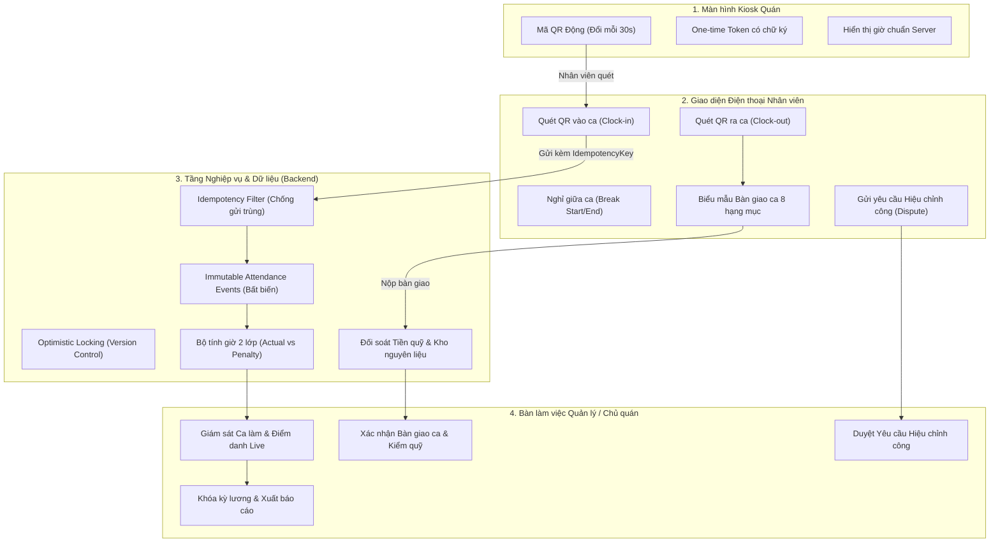
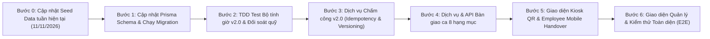

# Kế hoạch Triển khai Kỹ thuật: Chấm công QR Thông minh v2.0 & Bàn giao ca (Shift Handover) D'lat Cafe

> **Phiên bản:** 2.0 (Toàn diện)  
> **Áp dụng cho:** Quán D'lat Cafe (10–20 nhân sự, 3 ca làm việc, mô hình cà phê học bài & làm việc)  
> **Nguyên tắc nền tảng:** Đúng người – Đúng ca – Đúng giờ thực tế – Mọi thay đổi đều truy vết (Audit Log).  
> **Nguyên tắc phân tách:** Chấm công, Bàn giao ca và Tính lương là **3 tiến trình độc lập**. Không tự tiện trừ giờ công khi xảy ra sai sót bàn giao hay lệch tiền quỹ.

---

## 1. Cấu trúc tổng thể giải pháp (System Overview)



---

## 2. Kiến trúc Dữ liệu & Prisma Schema v2.0

### 2.1. Phân tách 4 trạng thái độc lập của Chấm công (Separated Status Dimensions)
Thay vì dùng 1 trường `status` đơn lẻ gây nhập nhằng, hệ thống chuẩn hóa thành 4 trường enum riêng biệt:

1. `completionStatus` (`AttendanceCompletionStatus`):
   * `IN_PROGRESS`: Đang trong ca (đã vào ca, chưa ra ca).
   * `COMPLETED`: Đã hoàn thành (có đủ cặp vào - ra ca).
   * `INCOMPLETE`: Ca thiếu (quên chấm ra hoặc bất thường chưa chốt).
2. `anomalyStatus` (`AttendanceAnomalyStatus`):
   * `CLEAN`: Chuẩn giờ, không có vi phạm.
   * `LATE`: Đi trễ.
   * `EARLY_LEAVE`: Về sớm.
   * `MISSING_CLOCK_OUT`: Quên chấm ra ca.
   * `OUT_OF_SCHEDULE`: Làm ngoài lịch đã công bố.
   * `NO_SHOW`: Vắng mặt không phép.
3. `approvalStatus` (`AttendanceApprovalStatus`):
   * `PENDING`: Chờ quản lý kiểm tra.
   * `APPROVED`: Đã duyệt hợp lệ.
   * `REJECTED`: Bị từ chối.
   * `ADJUSTED`: Đã qua hiệu chỉnh theo đơn đề xuất.
4. `payrollStatus` (`AttendancePayrollStatus`):
   * `UNPROCESSED`: Chưa đưa vào kỳ lương nào.
   * `INCLUDED`: Đã tổng hợp vào kỳ lương hiện tại.
   * `LOCKED`: Kỳ lương đã khóa, cấm sửa đổi trực tiếp.

### 2.2. Prisma Schema Delta

```prisma
// ==========================================
// 1. CÁC ENUM MỚI CHO CHẤM CÔNG V2.0 & BÀN GIAO
// ==========================================

enum AttendanceCompletionStatus {
  IN_PROGRESS
  COMPLETED
  INCOMPLETE
}

enum AttendanceAnomalyStatus {
  CLEAN
  LATE
  EARLY_LEAVE
  MISSING_CLOCK_OUT
  OUT_OF_SCHEDULE
  NO_SHOW
}

enum AttendanceApprovalStatus {
  PENDING
  APPROVED
  REJECTED
  ADJUSTED
}

enum AttendancePayrollStatus {
  UNPROCESSED
  INCLUDED
  LOCKED
}

enum HandoverStatus {
  PENDING       // Chưa nộp
  SUBMITTED     // Đã nộp, chờ ca sau/quản lý nhận
  CONFIRMED     // Đã xác nhận khớp
  DISCREPANCY   // Có chênh lệch quỹ/thiết bị cần giải trình
}

enum EquipmentStatus {
  GOOD          // Hoạt động tốt
  NEEDS_CHECK   // Cần kiểm tra
  DAMAGED       // Hư hỏng
}

enum StockStatus {
  SUFFICIENT    // Đủ hàng
  RUNNING_LOW   // Sắp hết
  OUT_OF_STOCK  // Hết hàng
  DAMAGED       // Hư hỏng
  EXPIRED       // Hết hạn
}

// ==========================================
// 2. MỞ RỘNG BẢNG ATTENDANCE & ATTENDANCE_EVENTS
// ==========================================

// Trong model Attendance:
// - Thêm version Int @default(1) (Optimistic concurrency control)
// - Bổ sung completionStatus, anomalyStatus, approvalStatus, payrollStatus
// - Tách biệt actualLateMinutes (thực tế) và penaltyLateMinutes (sau ân hạn)
// - Bổ sung earlyLeaveMinutes, otMinutes, approvedMinutes, paidMinutes

// Trong model AttendanceEvent:
// - Thêm idempotencyKey String? @unique (Chống quét lặp / mạng chập chờn)
// - Thêm deviceId String?
// - Thêm metadata Json? (lưu thông tin vị trí soft signal, IP client, v.v.)

// ==========================================
// 3. BẢNG QUẢN LÝ PHIÊN & THIẾT BỊ (SECURITY)
// ==========================================

model EmployeeSession {
  id          String    @id @default(uuid())
  userId      String
  deviceId    String    // Fingerprint trình duyệt di động
  ipAddress   String?
  userAgent   String?
  expiresAt   DateTime
  revokedAt   DateTime?
  createdAt   DateTime  @default(now())

  user        User      @relation(fields: [userId], references: [id], onDelete: Cascade)

  @@index([userId, deviceId])
  @@index([revokedAt])
  @@map("employee_sessions")
}

model KioskSession {
  id          String    @id @default(uuid())
  kioskCode   String    @default("DLAT_MAIN_KIOSK")
  tokenHash   String    @unique
  expiresAt   DateTime
  usedAt      DateTime?
  createdAt   DateTime  @default(now())

  @@index([tokenHash, expiresAt])
  @@map("kiosk_sessions")
}

// ==========================================
// 4. BẢNG HIỆU CHỈNH GIỜ CÔNG (ADJUSTMENT REQUESTS)
// ==========================================

model AttendanceAdjustmentRequest {
  id               String                      @id @default(uuid())
  attendanceId     String
  employeeId       String
  requestedType    String                      // "INCORRECT_CLOCK_IN", "INCORRECT_CLOCK_OUT", "MISSING_RECORD"
  proposedClockIn  DateTime?
  proposedClockOut DateTime?
  proposedMinutes  Int?
  reason           String                      // Lý do nhân viên khiếu nại/sửa
  status           AttendanceApprovalStatus    @default(PENDING)
  reviewedById     String?
  reviewedAt       DateTime?
  reviewNotes      String?
  createdAt        DateTime                    @default(now())
  updatedAt        DateTime                    @updatedAt

  attendance       Attendance                  @relation(fields: [attendanceId], references: [id], onDelete: Cascade)
  employee         Employee                    @relation(fields: [employeeId], references: [id], onDelete: Cascade)
  reviewedBy       User?                       @relation("AdjustmentReviewer", fields: [reviewedById], references: [id])

  @@index([attendanceId])
  @@index([employeeId, status])
  @@map("attendance_adjustment_requests")
}

// ==========================================
// 5. BẢNG BÀN GIAO CA (SHIFT HANDOVER - 8 HẠNG MỤC)
// ==========================================

model ShiftHandover {
  id                     String         @id @default(uuid())
  shiftId                String         @unique
  handoverEmployeeId     String         // Người giao ca
  receivingEmployeeId    String?        // Người nhận ca sau
  reviewerUserId         String?        // Quản lý/Chủ quán duyệt
  status                 HandoverStatus @default(PENDING)

  // 1. Thời gian
  submittedAt            DateTime?
  confirmedAt            DateTime?

  // 2. Doanh thu & Tiền quỹ (Đơn vị: Đồng - BigInt)
  openingCashVnd         BigInt         @default(0) // Tiền đầu ca (két giữ lại)
  cashSalesVnd           BigInt         @default(0) // Tiền mặt thu trong ca
  cashExpensesVnd        BigInt         @default(0) // Chi tiền mặt trong ca
  expectedClosingCashVnd BigInt         @default(0) // Tiền cuối ca dự kiến = Đầu + Thu - Chi
  actualClosingCashVnd   BigInt         @default(0) // Tiền mặt thực tế đếm được trong két
  cashDifferenceVnd      BigInt         @default(0) // Chênh lệch = Thực tế - Dự kiến
  cardSalesVnd           BigInt         @default(0) // Thẻ POS
  qrWalletSalesVnd       BigInt         @default(0) // Chuyển khoản / Ví Momo / VNPay
  posTotalSalesVnd       BigInt         @default(0) // Tổng doanh thu hệ thống POS
  cashDiscrepancyReason  String?        // Giải trình nếu lệch != 0

  // 3. Kho & Nguyên vật liệu tiêu hao nhanh (JSON Array)
  // [{ item: "Cà phê hạt", unit: "kg", quantity: 3.5, status: "SUFFICIENT" }, ...]
  stockReport            Json?

  // 4. Thiết bị & Tài sản (JSON Array)
  // [{ device: "Máy pha Nuova Simonelli", status: "GOOD", note: "" }, ...]
  equipmentReport        Json?

  // 5. Vệ sinh & Không gian (JSON Array Checklist)
  // [{ task: "Lau sạch khu bàn học tầng 1", done: true }, ...]
  cleanlinessReport      Json?

  // 6. Đơn hàng & Khách hàng
  customerNotes          String?        // Đồ thất lạc khách để quên, khiếu nại...

  // 7. Công việc tồn đọng cho ca sau
  pendingTasks           String?        // Việc cần làm: nhận đá, kiểm hạn syrup...

  // 8. Chữ ký & Ghi chú chung
  handoverNotes          String?
  reviewNotes            String?

  createdAt              DateTime       @default(now())
  updatedAt              DateTime       @updatedAt

  shift                  Shift          @relation(fields: [shiftId], references: [id], onDelete: Cascade)
  handoverEmployee       Employee       @relation("HandoverGiver", fields: [handoverEmployeeId], references: [id])
  receivingEmployee      Employee?      @relation("HandoverReceiver", fields: [receivingEmployeeId], references: [id])
  reviewerUser           User?          @relation("HandoverReviewer", fields: [reviewerUserId], references: [id])

  @@index([status])
  @@map("shift_handovers")
}
```

---

## 3. Quy tắc Nghiệp vụ & Công thức Cốt lõi

### 3.1. Chấm công: Phân biệt Thời gian Đi trễ & Giờ làm có lương
* `scheduledMinutes = max(0, (shiftEnd - shiftStart) / 60000 - breakMinutes)`
* `workedMinutes = max(0, (clockOut - clockIn) / 60000 - breakMinutes)`
* **Quy tắc Ân hạn (Grace Period):**
  * Ân hạn cấu hình mặc định: **5 phút** (sau giờ bắt đầu ca).
  * `actualLateMinutes = max(0, round((clockIn - shiftStart) / 60000))`
  * `penaltyLateMinutes`:
    * Nếu `actualLateMinutes <= graceMinutes` -> `0` phút phạt (nhưng vẫn lưu `actualLateMinutes` để theo dõi thói quen).
    * Nếu `actualLateMinutes > graceMinutes` -> `actualLateMinutes - graceMinutes` (hoặc tính toàn bộ tùy cấu hình quán).
* **Quy tắc Tăng ca (Overtime - OT):**
  * Nhân viên về muộn không tự động tính OT.
  * `otMinutes` chỉ được cộng vào `paidMinutes` khi Quản lý duyệt:
    `paidMinutes = min(scheduledMinutes, workedMinutes) + approvedOtMinutes`

### 3.2. Bàn giao ca: Công thức Đối soát Tiền quỹ
* `Tiền cuối ca dự kiến = Tiền đầu ca (két giữ lại) + Thu tiền mặt - Chi tiền mặt`
* `Chênh lệch tiền quỹ = Tiền mặt thực đếm - Tiền cuối ca dự kiến`
* **Nguyên tắc:** Nếu `Chênh lệch != 0`, form bắt buộc nhân viên giao ca nhập trường `cashDiscrepancyReason`. Quản lý sẽ nhận thông báo để xác minh khi nhận ca.

### 3.3. Nguyên tắc Phân tách Độc lập (Separation of Concerns)
| Khía cạnh | Xử lý | Ảnh hưởng tới Lương |
| :--- | :--- | :--- |
| **Giờ làm thực tế** | Ghi nhận qua Chấm công QR (Clock-in / Clock-out) | **Có:** Là cơ sở tính `paidMinutes`. |
| **Quên chấm ra** | Chuyển thành `MISSING_CLOCK_OUT`, nhân viên gửi Đơn hiệu chỉnh kèm xác nhận | Quản lý duyệt giờ thực tế mới tính lương. |
| **Chênh lệch quỹ tiền** | Ghi vào `ShiftHandover`, tạo biên bản giải trình nội bộ | **Không tự động trừ giờ công:** Lương giờ vẫn tính đủ theo số phút làm việc; việc bồi thường hoặc xử phạt quỹ tiền tuân thủ quy chế tài chính riêng của quán. |
| **Vệ sinh chưa sạch / Thiết bị lỗi** | Đánh giá qua checklist bàn giao ca, phản ánh vào KPI chuyên cần/thưởng | Không được dùng để cắt giảm giờ công làm việc thực tế. |

---

## 4. Xử lý 10 Nhóm Tình huống Thực tế (Edge Cases Matrix)

| Nhóm | Trường hợp | Cơ chế Hệ thống Xử lý |
| :--- | :--- | :--- |
| **#6 Lỗi mạng & Thiết bị** | Điện thoại mất mạng | Hiển thị thông báo đỏ trên màn hình điện thoại; không ghi nhận ảo. Nhân viên báo Quản lý để sau đó nộp Yêu cầu bổ sung công. |
| | Mạng chập chờn gửi lặp | Dùng `idempotencyKey = hash(employeeId + shiftId + action + timestamp_rounded_10s)`. Nếu request lặp lại, server trả về kết quả đã cache, không tạo duplicate event. |
| **#7 Sai thao tác** | Quên quét vào nhưng vẫn làm | Nhân viên ấn "Gửi yêu cầu bổ sung công", chọn ca, điền giờ vào thực tế và lý do. Quản lý duyệt -> chuyển trạng thái `ADJUSTED`. |
| | Quên quét ra | Hết ngày, cron job tự động đánh dấu `completionStatus: INCOMPLETE`, `anomalyStatus: MISSING_CLOCK_OUT`, bắn cảnh báo lên Dashboard quản lý. |
| | Bấm lặp nút quét | Nút bấm client debounce 3 giây; backend kiểm tra nếu trạng thái hiện tại đã là `IN_PROGRESS` thì chặn thao tác `CLOCK_IN` thứ hai. |
| **#8 Lịch ca đặc biệt** | Đến sớm 30–60 phút | Chấp nhận check-in, nhưng `workedMinutes` chỉ bắt đầu tính từ giờ chuẩn của ca (không tự động tính OT). |
| | Ca vắt qua nửa đêm (23:00) | Hệ thống lưu `workDate` theo ngày bắt đầu ca (hoặc chuẩn Date UTC không phụ thuộc múi giờ), tính khoảng cách theo miligiây của `startAt` và `endAt`. |
| **#9 Chống gian lận** | Gửi ảnh chụp QR cho bạn | Mã QR Kiosk đổi token mỗi 30 giây, kết hợp kiểm tra User-Agent / IP nội bộ mạng Wi-Fi quán (soft check). |
| | Đăng nhập 2 máy cùng lúc | Bảng `employee_sessions` ghi nhận device fingerprint. Đăng nhập máy mới có thể thu hồi phiên cũ hoặc gắn cờ cảnh báo bất thường. |
| **#10 Hiệu chỉnh công** | 2 Quản lý cùng sửa 1 bản ghi | **Optimistic Locking**: Khi update, Prisma kiểm tra `where: { id, version: currentVersion }` và tăng `version: { increment: 1 }`. Quản lý sửa sau sẽ nhận thông báo bản ghi đã thay đổi và cần tải lại trang. |

---

## 5. Thiết kế Giao diện Người dùng (UI / UX)

### Màn hình 1: Kiosk QR Động (`/kiosk/qr`)
* Màn hình toàn màn hình (Full-screen) hiển thị trên tablet quầy bar.
* Đồng hồ số thời gian thực chuẩn múi giờ `Asia/Ho_Chi_Minh`.
* Mã QR tự động sinh lại mỗi 30 giây kèm hiệu ứng đếm ngược tròn.
* Thông báo chào đón khi có nhân viên quét thành công (tên nhân viên, ca làm, giờ vào).

### Màn hình 2: Nhân viên Di động (`/employee/attendance` & `/employee/handover`)
* Thẻ ca làm hôm nay: Tên ca, giờ phân công, nút hành động lớn (Chấm Vào / Nghỉ / Chấm Ra).
* Nút *"Gửi yêu cầu hiệu chỉnh"* khi quên chấm công hoặc sai giờ.
* Khi nhấn Chấm ra ca -> Modal nhắc nhở chuyển sang màn hình **Biểu mẫu Bàn giao ca (Shift Handover)**:
  * Điền số tiền mặt đếm trong két -> tự động tính chênh lệch so với doanh thu POS.
  * Checklist nhanh 5 nhóm: Kho sữa/cà phê, Máy móc, Khu bàn học, Đồ khách bỏ quên, Việc tồn.
  * Chọn người nhận ca sau và nhấn **"Gửi bàn giao ca"**.

### Màn hình 3: Quản lý Ca làm & Chấm công Live (`/attendance`)
* Danh sách nhân viên đang trong ca thời gian thực.
* Badge trạng thái phân màu rõ ràng (Đúng giờ: Xanh lục, Trễ: Vàng hổ phách, Quên ra: Đỏ).
* Tab riêng: **"Yêu cầu hiệu chỉnh công"** với nút Duyệt / Từ chối kèm ghi chú.

### Màn hình 4: Bàn giao ca & Quản lý Tiền két (`/handovers`)
* Danh sách các biên bản bàn giao ca theo ngày.
* Cảnh báo nổi bật nếu có ca bị **Lệch tiền quỹ** hoặc **Thiết bị báo hỏng**.
* Quản lý bấm "Xác nhận duyệt bàn giao" để lưu vào hồ sơ kiểm toán.

---

## 6. Kế hoạch Triển khai Từng bước (Actionable Roadmap)



### Chi tiết các bước thực hiện:
1. **Bước 0: Cập nhật Seed Data tuần hiện tại (11/11/2026)**
   * Chuyển đổi `prisma/seed-operational-data.ts` thành hàm tính động theo ngày chạy thực tế (Tuần 46: 09/11 - 15/11/2026).
   * Tạo 21 ca làm việc cho tuần này, phân bổ 13 nhân viên, gán sẵn dữ liệu chấm công ngày 11/11/2026 để Dashboard hiển thị số liệu thực tế ngay.
2. **Bước 1: Prisma Schema Delta & DB Push**
   * Bổ sung các Enum và Model mới (`ShiftHandover`, `AttendanceAdjustmentRequest`, `EmployeeSession`, `KioskSession`).
   * Bổ sung trường `version`, `idempotencyKey`, 4 trạng thái độc lập vào `Attendance` và `AttendanceEvent`.
   * Chạy `npx prisma db push` và `npx prisma generate`.
3. **Bước 2: TDD Test cho Logic nghiệp vụ v2.0**
   * Viết test `tests/unit/attendance-calculator-v2.test.ts`: test ân hạn trễ, test quên chấm ra, test OT duyệt.
   * Viết test `tests/unit/shift-handover-calculator.test.ts`: test công thức đối soát tiền két và bắt buộc giải trình khi lệch.
4. **Bước 3: Attendance Service v2.0 với Idempotency & Optimistic Locking**
   * Xử lý khóa trùng `idempotencyKey` tại `src/modules/attendance/attendance.service.ts`.
   * Cập nhật logic bản ghi với kiểm tra `version`.
5. **Bước 4: Shift Handover Service & API**
   * Xây dựng API `POST /api/handovers` (Nhân viên nộp bàn giao).
   * Xây dựng API `GET /api/handovers` & `PUT /api/handovers/[id]/confirm` (Quản lý duyệt).
6. **Bước 5: Giao diện Kiosk & Di động**
   * Tạo trang `/kiosk/qr` với mã QR xoay vòng 30s.
   * Cập nhật `/employee/attendance` hỗ trợ nút bấm nộp bàn giao ca sau khi clock-out.
7. **Bước 6: Giao diện Quản lý & Xác minh Toàn diện**
   * Tạo trang `/handovers` cho quản lý kiểm tra tiền quỹ và checklist.
   * Chạy kiểm thử tự động `npm test` và `npm run build`.

